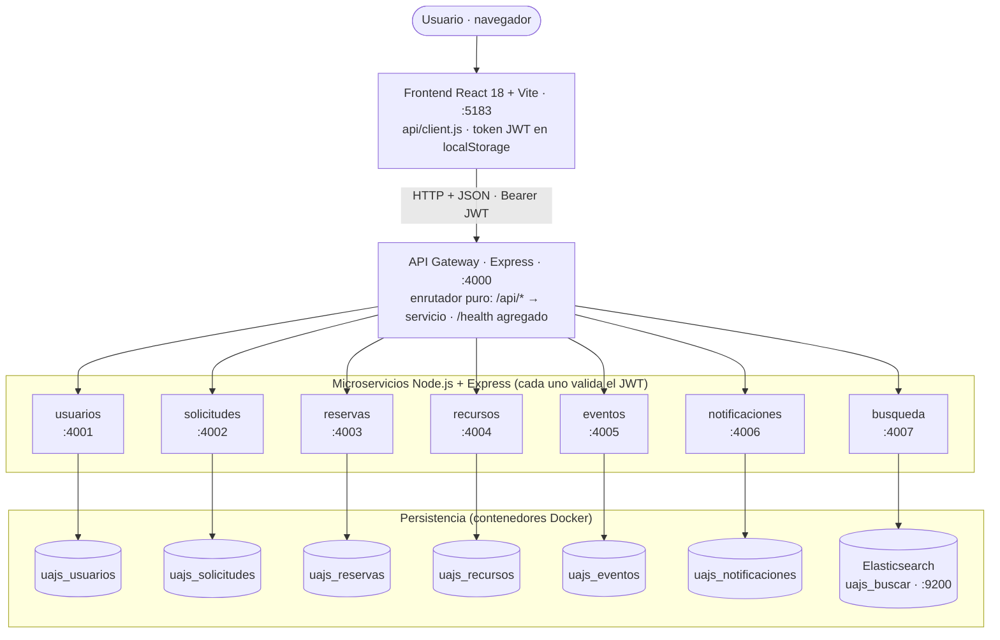
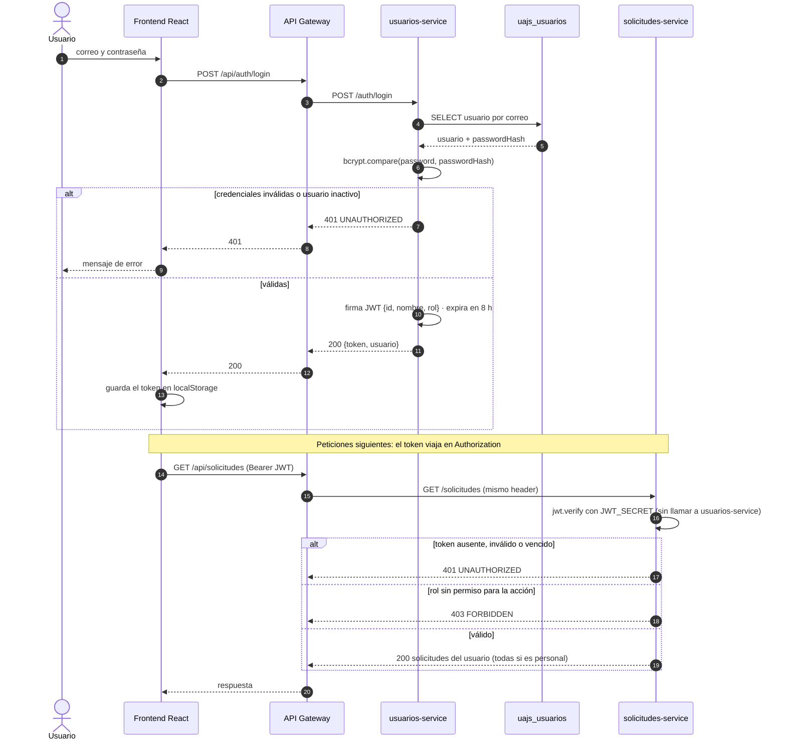
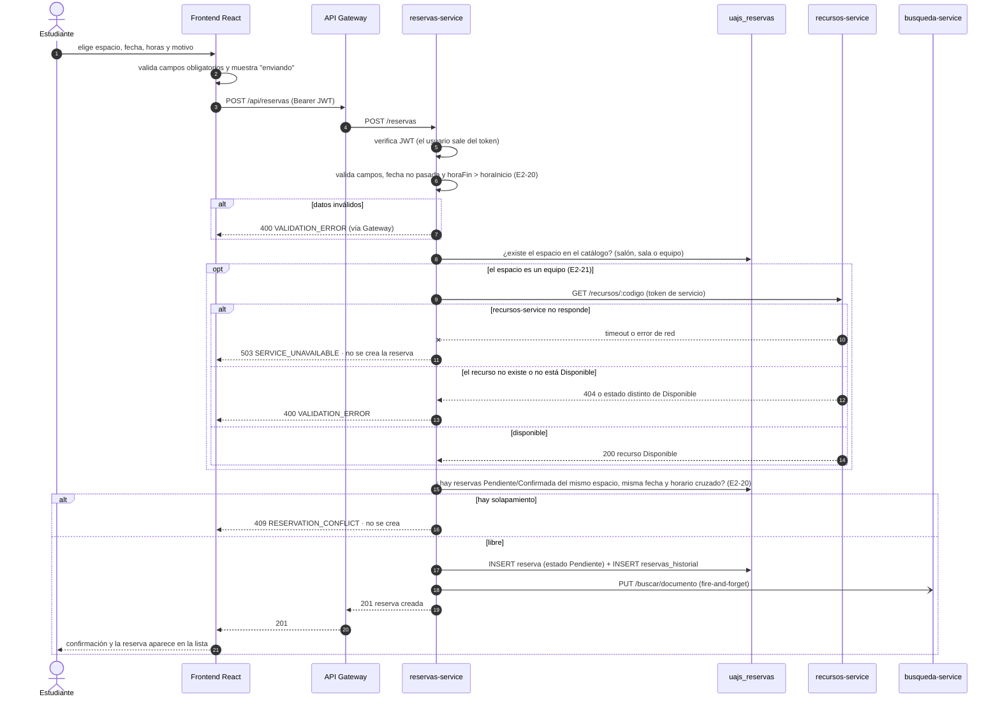
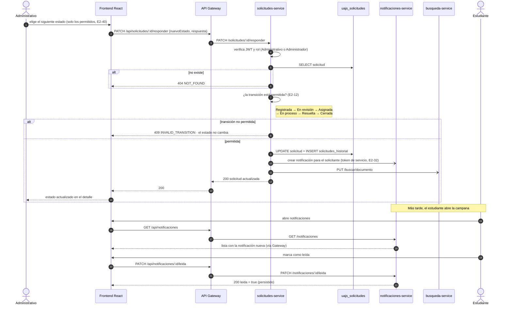
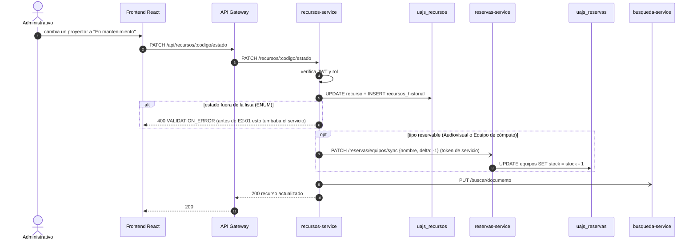

# Arquitectura y comunicación entre servicios — UAJS Smart Campus

Diagramas del Entregable 2 (Fase 7 de la guía: "diagrama de secuencia o
flujo" y "comunicaciones entre servicios documentadas, con control de
fallos"). Están en Mermaid, así que GitHub los dibuja directamente; las
versiones en imagen para el documento técnico están en [`img/`](img/) y se
regeneran con `bash arquitectura/exportar.sh`.

Contenido:

1. [Arquitectura general](#1-arquitectura-general)
2. [Inicio de sesión y petición autenticada](#2-inicio-de-sesión-y-petición-autenticada)
3. [Crear una reserva con validación remota](#3-crear-una-reserva-con-validación-remota)
4. [Cambio de estado de una solicitud con notificación](#4-cambio-de-estado-de-una-solicitud-con-notificación)
5. [Cambio de estado de un recurso y sincronización de stock](#5-cambio-de-estado-de-un-recurso-y-sincronización-de-stock)
6. [Resumen de comunicaciones entre servicios](#6-resumen-de-comunicaciones-entre-servicios)
7. [Riesgos conocidos](#7-riesgos-conocidos)

> **Convención:** lo marcado como *E2-xx* es comportamiento que se implementa
> en esa tarea del Entregable 2 (ClickUp). El resto ya existe en `develop`.

---

## 1. Arquitectura general

### 1.1 Capas y despliegue

Las 6 bases `uajs_*` viven en **un solo contenedor PostgreSQL 16**
(`uajs-postgres`, puerto 5432), pero cada una es exclusiva de su servicio.

### 1.2 Comunicación entre microservicios

```mermaid
flowchart LR
  subgraph NEG["Servicios de negocio"]
    direction TB
    US["usuarios-service"]
    SO["solicitudes-service"]
    EV["eventos-service"]
    RE["reservas-service"]
    RC["recursos-service"]
  end

  RC -- "sincroniza stock" --> RE
  RE -. "valida recurso · E2-21" .-> RC

  SO -.-> JN(( ))
  RE -.-> JN
  EV -.-> JN
  JN -. "notifica · E2-32" .-> NO["notificaciones-service"]

  NEG --> BU["busqueda-service<br/>todos indexan con<br/>PUT /buscar/documento"]
```

Línea continua: ya existe en `develop`. Línea punteada: se implementa en la
tarea indicada. El detalle de cada llamada está en la
[sección 6](#6-resumen-de-comunicaciones-entre-servicios).

**Cómo leerlo:**

- El navegador **solo** habla con el Gateway (`:4000`). Nunca conoce los
  puertos de los microservicios ni toca una base de datos.
- El Gateway es un **enrutador puro**: quita el prefijo `/api` y reenvía la
  petición al servicio dueño de esa ruta (`/api/solicitudes` →
  solicitudes-service). No valida tokens ni tiene lógica de negocio; si un
  servicio no responde, devuelve `502 SERVICE_UNAVAILABLE`.
- Cada microservicio **valida el JWT por su cuenta** (mismo `JWT_SECRET`) y es
  el **único dueño** de su base. Las 6 bases viven en un solo contenedor
  PostgreSQL, pero separadas.
- Las flechas punteadas son llamadas **HTTP síncronas entre servicios**. Las
  de sincronización, indexación y notificación son *fire-and-forget*: si el
  servicio destino está caído, la operación principal igual se completa y el
  error queda en el log. La validación de recurso (E2-21) es la excepción:
  si falla, la reserva **no** se crea.

---

## 2. Inicio de sesión y petición autenticada

**Decisión:** la sesión no se guarda en ningún servidor (JWT sin estado).
Cada servicio verifica la firma localmente, así no depende de que
usuarios-service esté arriba para atender peticiones ya autenticadas.

---

## 3. Crear una reserva con validación remota

Implementa las reglas de la guía 7.5 y 8.5. Tareas: E2-20 (fechas y
solapamiento) y E2-21 (validar el espacio o recurso).

**Control de fallos:** la consulta a recursos-service es **bloqueante**. Si
no responde, se devuelve un error controlado y no se guarda una reserva
inconsistente (guía 8.5). La indexación en búsqueda no bloquea: si
busqueda-service está caído, la reserva igual se crea.

---

## 4. Cambio de estado de una solicitud con notificación

Tareas: E2-12 (transiciones permitidas) y E2-32 (notificación generada por
el servicio, no por el frontend).

**Control de fallos:** si notificaciones-service está caído, el cambio de
estado igual se guarda (la notificación es secundaria) y el error queda en el
log del servicio. Hoy (antes de E2-32) es el frontend quien crea la
notificación después de una respuesta exitosa.

---

## 5. Cambio de estado de un recurso y sincronización de stock

Comportamiento que **ya existe**: recursos-service es la fuente de verdad
del inventario, y reservas-service mantiene una réplica del stock reservable
por nombre de equipo.

**Control de fallos:** la sincronización es *fire-and-forget*. Si
reservas-service está caído, el recurso igual cambia de estado y el stock
queda desfasado en una unidad hasta la siguiente sincronización (limitación
conocida, ver sección 7).

---

## 6. Resumen de comunicaciones entre servicios

| Origen → destino | Endpoint | Cuándo | ¿Bloquea la operación? | Si el destino falla |
|---|---|---|---|---|
| Frontend → Gateway | `/api/*` | Toda petición del usuario | Sí | `502 SERVICE_UNAVAILABLE`; la interfaz muestra el error |
| Gateway → servicio | ruta sin `/api` | Toda petición | Sí | `502` con formato único de error |
| recursos → reservas | `PATCH /reservas/equipos/sync` | Crear, editar, cambiar estado o eliminar un recurso reservable | No | Se registra en log; el stock puede quedar desfasado |
| reservas → recursos *(E2-21)* | `GET /recursos/:codigo` | Crear una reserva de equipo | **Sí** | `503`; no se crea la reserva |
| solicitudes, reservas, eventos → notificaciones *(E2-32)* | endpoint interno de notificaciones | Cambio de estado, confirmación, inscripción | No | Se registra en log; la operación se completa |
| usuarios, solicitudes, reservas, recursos, eventos → búsqueda | `PUT /buscar/documento`, `DELETE /buscar/documento/:tipo/:id` | Crear, editar o eliminar algo indexable | No | Se registra en log; el índice se recupera con `backfill` |

**Autenticación entre servicios:** las llamadas internas llevan un *token de
servicio* firmado con el mismo `JWT_SECRET`, con 1 minuto de vigencia y sin
usuario real detrás (`id: 0`).

**Formato de error común (E2-01):** todos los servicios y el Gateway
responden los errores como
`{ "success": false, "error": { "code": "...", "message": "..." } }`.

---

## 7. Riesgos conocidos

| Riesgo | Impacto | Propuesta |
|---|---|---|
| Los endpoints internos de búsqueda (`PUT` y `DELETE /buscar/documento`) aceptan el token de **cualquier usuario**, y el Gateway los publica en `/api/buscar/documento`. | Un usuario autenticado podría insertar o borrar resultados del buscador. | Aceptar solo tokens de servicio (marcarlos con un campo `servicio`) o no exponer esas rutas en el Gateway. |
| El `JWT_SECRET` de los `.env.example` es un valor de relleno público. | Con él se pueden fabricar tokens válidos. | Generar uno nuevo antes de cualquier despliegue (ver `SEGURIDAD.md` de la rama de Maicol). |
| Sincronización de stock *fire-and-forget*. | Si reservas-service está caído durante un cambio de recurso, el stock queda desfasado. | Reintentos o una cola de mensajes (RabbitMQ), propuesto para el Entregable 3. |
| Comunicación síncrona HTTP en todas las integraciones. | Un servicio lento retrasa al que lo llama. | Timeouts explícitos en los clientes HTTP y mensajería asíncrona en el Entregable 3. |
