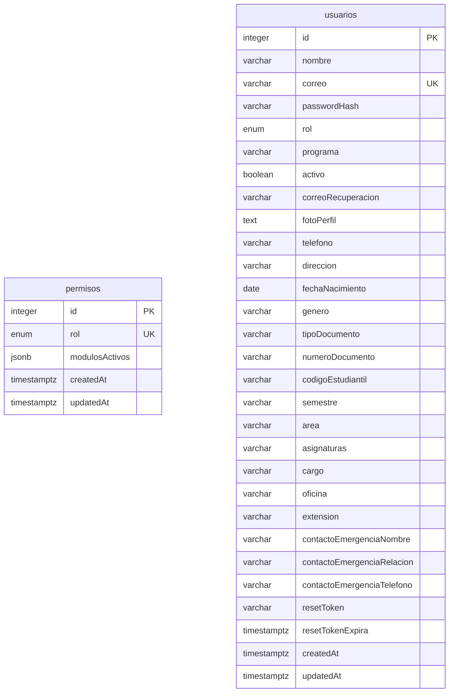
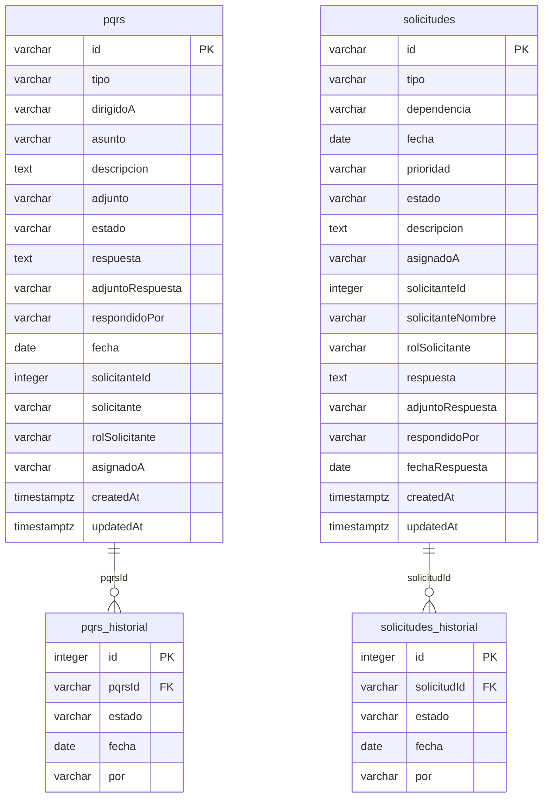
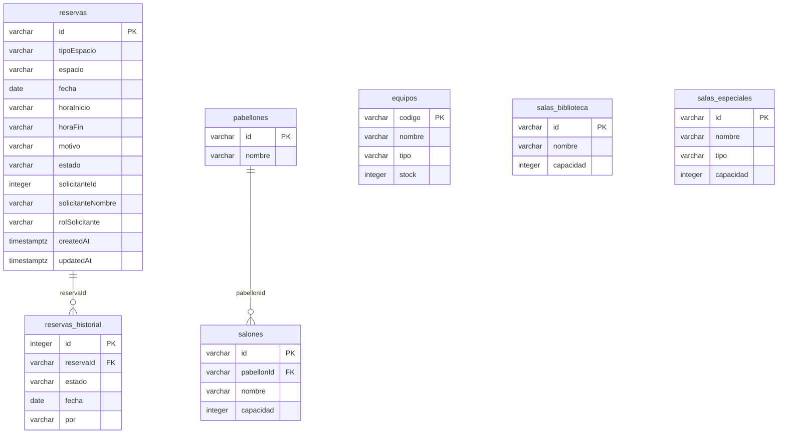
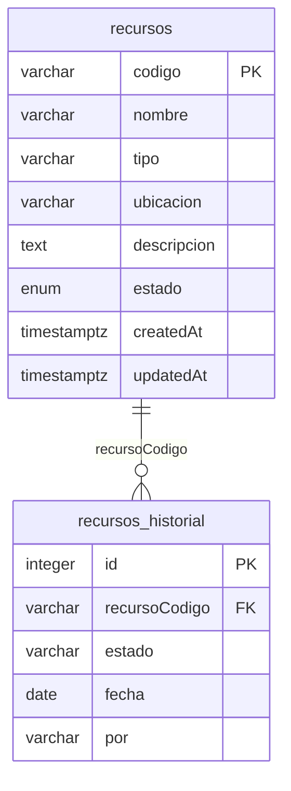
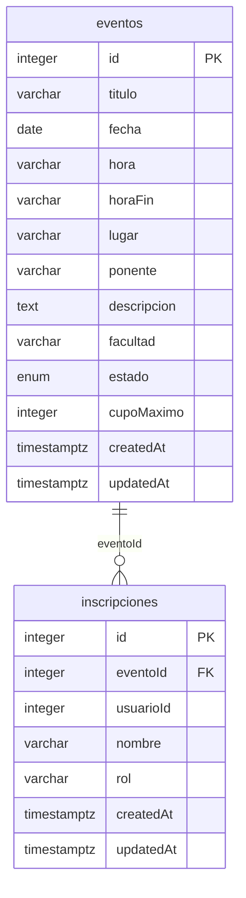
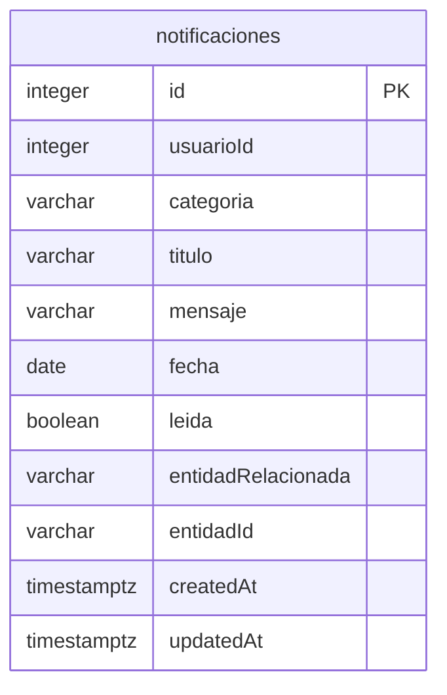

# Modelo de datos — UAJS Smart Campus

> Archivo generado por `database/generar-diccionario.mjs` a partir de la
> estructura real de las bases. No editar a mano: cambiar el modelo en el
> microservicio, recrear la base y volver a correr el generador. La parte
> escrita a mano (decisiones de diseño, propiedad de los datos) está en
> `database/README.md`.

Seis bases PostgreSQL, una por microservicio de negocio. `busqueda-service`
no tiene base relacional: usa un índice de Elasticsearch (`uajs_buscar`)
que alimentan los demás servicios.

Convenciones: **PK** llave primaria, **FK** llave foránea, **UK** valor
único. Las llaves foráneas solo existen entre tablas de la misma base; las
referencias a datos de otro microservicio (por ejemplo `solicitanteId`, que
apunta a un usuario) son referencias lógicas por id, sin llave foránea,
porque viven en otra base.

## `uajs_usuarios` — usuarios-service (4001)

### Tabla `permisos`

Módulos habilitados para cada rol gestionable. El Administrador del sistema siempre tiene acceso total y no aparece aquí.

| Columna | Tipo | Nulo | Por defecto | Restricciones |
|---|---|---|---|---|
| `id` | INTEGER | No | autoincremental | PK |
| `rol` | ENUM | No |  | UNIQUE; Valores: Estudiante, Docente, Administrativo |
| `modulosActivos` | JSONB | No | '[]' |  |
| `createdAt` | TIMESTAMPTZ | No |  |  |
| `updatedAt` | TIMESTAMPTZ | No |  |  |

### Tabla `usuarios`

Cuentas de la plataforma: datos personales, rol, registro académico/laboral y token de recuperación de contraseña.

| Columna | Tipo | Nulo | Por defecto | Restricciones |
|---|---|---|---|---|
| `id` | INTEGER | No | autoincremental | PK |
| `nombre` | VARCHAR(255) | No |  |  |
| `correo` | VARCHAR(255) | No |  | UNIQUE |
| `passwordHash` | VARCHAR(255) | No |  |  |
| `rol` | ENUM | No |  | Valores: Estudiante, Docente, Administrativo, Administrador del sistema |
| `programa` | VARCHAR(255) | Sí |  |  |
| `activo` | BOOLEAN | No | true |  |
| `correoRecuperacion` | VARCHAR(255) | Sí |  |  |
| `fotoPerfil` | TEXT | Sí |  |  |
| `telefono` | VARCHAR(255) | Sí |  |  |
| `direccion` | VARCHAR(255) | Sí |  |  |
| `fechaNacimiento` | DATE | Sí |  |  |
| `genero` | VARCHAR(255) | Sí |  |  |
| `tipoDocumento` | VARCHAR(255) | Sí |  |  |
| `numeroDocumento` | VARCHAR(255) | Sí |  |  |
| `codigoEstudiantil` | VARCHAR(255) | Sí |  |  |
| `semestre` | VARCHAR(255) | Sí |  |  |
| `area` | VARCHAR(255) | Sí |  |  |
| `asignaturas` | VARCHAR(255) | Sí |  |  |
| `cargo` | VARCHAR(255) | Sí |  |  |
| `oficina` | VARCHAR(255) | Sí |  |  |
| `extension` | VARCHAR(255) | Sí |  |  |
| `contactoEmergenciaNombre` | VARCHAR(255) | Sí |  |  |
| `contactoEmergenciaRelacion` | VARCHAR(255) | Sí |  |  |
| `contactoEmergenciaTelefono` | VARCHAR(255) | Sí |  |  |
| `resetToken` | VARCHAR(255) | Sí |  |  |
| `resetTokenExpira` | TIMESTAMPTZ | Sí |  |  |
| `createdAt` | TIMESTAMPTZ | No |  |  |
| `updatedAt` | TIMESTAMPTZ | No |  |  |

## `uajs_solicitudes` — solicitudes-service (4002)

### Tabla `pqrs`

Peticiones, quejas, reclamos y sugerencias, con el responsable asignado y la respuesta.

| Columna | Tipo | Nulo | Por defecto | Restricciones |
|---|---|---|---|---|
| `id` | VARCHAR(255) | No |  | PK |
| `tipo` | VARCHAR(255) | No |  |  |
| `dirigidoA` | VARCHAR(255) | No |  |  |
| `asunto` | VARCHAR(255) | No |  |  |
| `descripcion` | TEXT | No |  |  |
| `adjunto` | VARCHAR(255) | Sí |  |  |
| `estado` | VARCHAR(255) | No | 'Registrada' |  |
| `respuesta` | TEXT | Sí |  |  |
| `adjuntoRespuesta` | VARCHAR(255) | Sí |  |  |
| `respondidoPor` | VARCHAR(255) | Sí |  |  |
| `fecha` | DATE | No |  |  |
| `solicitanteId` | INTEGER | No |  |  |
| `solicitante` | VARCHAR(255) | No |  |  |
| `rolSolicitante` | VARCHAR(255) | No |  |  |
| `asignadoA` | VARCHAR(255) | No | 'Sin asignar' |  |
| `createdAt` | TIMESTAMPTZ | No |  |  |
| `updatedAt` | TIMESTAMPTZ | No |  |  |

### Tabla `pqrs_historial`

Cada cambio de estado de una PQRS.

| Columna | Tipo | Nulo | Por defecto | Restricciones |
|---|---|---|---|---|
| `id` | INTEGER | No | autoincremental | PK |
| `pqrsId` | VARCHAR(255) | No |  | FK → `pqrs` (ON DELETE CASCADE) |
| `estado` | VARCHAR(255) | No |  |  |
| `fecha` | DATE | No |  |  |
| `por` | VARCHAR(255) | No |  |  |

### Tabla `solicitudes`

Trámites académicos radicados (certificados, constancias, cambios de horario, etc.) con su estado y respuesta oficial.

| Columna | Tipo | Nulo | Por defecto | Restricciones |
|---|---|---|---|---|
| `id` | VARCHAR(255) | No |  | PK |
| `tipo` | VARCHAR(255) | No |  |  |
| `dependencia` | VARCHAR(255) | No |  |  |
| `fecha` | DATE | No |  |  |
| `prioridad` | VARCHAR(255) | No | 'Media' |  |
| `estado` | VARCHAR(255) | No | 'Registrada' |  |
| `descripcion` | TEXT | No |  |  |
| `asignadoA` | VARCHAR(255) | Sí |  |  |
| `solicitanteId` | INTEGER | No |  |  |
| `solicitanteNombre` | VARCHAR(255) | No |  |  |
| `rolSolicitante` | VARCHAR(255) | No |  |  |
| `respuesta` | TEXT | Sí |  |  |
| `adjuntoRespuesta` | VARCHAR(255) | Sí |  |  |
| `respondidoPor` | VARCHAR(255) | Sí |  |  |
| `fechaRespuesta` | DATE | Sí |  |  |
| `createdAt` | TIMESTAMPTZ | No |  |  |
| `updatedAt` | TIMESTAMPTZ | No |  |  |

### Tabla `solicitudes_historial`

Cada cambio de estado de una solicitud: quién lo hizo y cuándo.

| Columna | Tipo | Nulo | Por defecto | Restricciones |
|---|---|---|---|---|
| `id` | INTEGER | No | autoincremental | PK |
| `solicitudId` | VARCHAR(255) | No |  | FK → `solicitudes` (ON DELETE CASCADE) |
| `estado` | VARCHAR(255) | No |  |  |
| `fecha` | DATE | No |  |  |
| `por` | VARCHAR(255) | No |  |  |

## `uajs_reservas` — reservas-service (4003)

### Tabla `equipos`

Catálogo de equipos reservables y sus unidades disponibles; se sincroniza con recursos-service.

| Columna | Tipo | Nulo | Por defecto | Restricciones |
|---|---|---|---|---|
| `codigo` | VARCHAR(255) | No |  | PK |
| `nombre` | VARCHAR(255) | No |  |  |
| `tipo` | VARCHAR(255) | No |  |  |
| `stock` | INTEGER | No | 1 |  |

### Tabla `pabellones`

Bloques físicos del campus que agrupan salones.

| Columna | Tipo | Nulo | Por defecto | Restricciones |
|---|---|---|---|---|
| `id` | VARCHAR(255) | No |  | PK |
| `nombre` | VARCHAR(255) | No |  |  |

### Tabla `reservas`

Reservas de espacios o equipos: espacio, fecha, franja horaria, motivo y estado.

| Columna | Tipo | Nulo | Por defecto | Restricciones |
|---|---|---|---|---|
| `id` | VARCHAR(255) | No |  | PK |
| `tipoEspacio` | VARCHAR(255) | No |  |  |
| `espacio` | VARCHAR(255) | No |  |  |
| `fecha` | DATE | No |  |  |
| `horaInicio` | VARCHAR(255) | No |  |  |
| `horaFin` | VARCHAR(255) | No |  |  |
| `motivo` | VARCHAR(255) | No |  |  |
| `estado` | VARCHAR(255) | No | 'Pendiente' |  |
| `solicitanteId` | INTEGER | No |  |  |
| `solicitanteNombre` | VARCHAR(255) | No |  |  |
| `rolSolicitante` | VARCHAR(255) | No |  |  |
| `createdAt` | TIMESTAMPTZ | No |  |  |
| `updatedAt` | TIMESTAMPTZ | No |  |  |

### Tabla `reservas_historial`

Cada cambio de estado de una reserva.

| Columna | Tipo | Nulo | Por defecto | Restricciones |
|---|---|---|---|---|
| `id` | INTEGER | No | autoincremental | PK |
| `reservaId` | VARCHAR(255) | No |  | FK → `reservas` (ON DELETE CASCADE) |
| `estado` | VARCHAR(255) | No |  |  |
| `fecha` | DATE | No |  |  |
| `por` | VARCHAR(255) | No |  |  |

### Tabla `salas_biblioteca`

Salas de estudio de la biblioteca.

| Columna | Tipo | Nulo | Por defecto | Restricciones |
|---|---|---|---|---|
| `id` | VARCHAR(255) | No |  | PK |
| `nombre` | VARCHAR(255) | No |  |  |
| `capacidad` | INTEGER | No |  |  |

### Tabla `salas_especiales`

Salas reservables con un uso particular (auditorio, sala de juntas, laboratorios).

| Columna | Tipo | Nulo | Por defecto | Restricciones |
|---|---|---|---|---|
| `id` | VARCHAR(255) | No |  | PK |
| `nombre` | VARCHAR(255) | No |  |  |
| `tipo` | VARCHAR(255) | No |  |  |
| `capacidad` | INTEGER | No |  |  |

### Tabla `salones`

Salones de clase reservables, con su capacidad.

| Columna | Tipo | Nulo | Por defecto | Restricciones |
|---|---|---|---|---|
| `id` | VARCHAR(255) | No |  | PK |
| `pabellonId` | VARCHAR(255) | No |  | FK → `pabellones` (ON DELETE CASCADE) |
| `nombre` | VARCHAR(255) | No |  |  |
| `capacidad` | INTEGER | No |  |  |

## `uajs_recursos` — recursos-service (4004)

### Tabla `recursos`

Inventario de recursos físicos y tecnológicos con su ubicación y estado.

| Columna | Tipo | Nulo | Por defecto | Restricciones |
|---|---|---|---|---|
| `codigo` | VARCHAR(255) | No |  | PK |
| `nombre` | VARCHAR(255) | No |  |  |
| `tipo` | VARCHAR(255) | No |  |  |
| `ubicacion` | VARCHAR(255) | No |  |  |
| `descripcion` | TEXT | Sí |  |  |
| `estado` | ENUM | No | 'Disponible' | Valores: Disponible, En mantenimiento, Fuera de servicio |
| `createdAt` | TIMESTAMPTZ | No |  |  |
| `updatedAt` | TIMESTAMPTZ | No |  |  |

### Tabla `recursos_historial`

Cada cambio de estado de un recurso.

| Columna | Tipo | Nulo | Por defecto | Restricciones |
|---|---|---|---|---|
| `id` | INTEGER | No | autoincremental | PK |
| `recursoCodigo` | VARCHAR(255) | No |  | FK → `recursos` (ON DELETE CASCADE) |
| `estado` | VARCHAR(255) | No |  |  |
| `fecha` | DATE | No |  |  |
| `por` | VARCHAR(255) | No |  |  |

## `uajs_eventos` — eventos-service (4005)

### Tabla `eventos`

Agenda institucional: eventos por facultad, con cupo máximo opcional y estado.

| Columna | Tipo | Nulo | Por defecto | Restricciones |
|---|---|---|---|---|
| `id` | INTEGER | No | autoincremental | PK |
| `titulo` | VARCHAR(255) | No |  |  |
| `fecha` | DATE | No |  |  |
| `hora` | VARCHAR(255) | No |  |  |
| `horaFin` | VARCHAR(255) | Sí |  |  |
| `lugar` | VARCHAR(255) | No |  |  |
| `ponente` | VARCHAR(255) | No |  |  |
| `descripcion` | TEXT | Sí |  |  |
| `facultad` | VARCHAR(255) | No | 'General / Bienestar Universitario' |  |
| `estado` | ENUM | No | 'Activo' | Valores: Activo, Inactivo, Cancelado |
| `cupoMaximo` | INTEGER | Sí |  |  |
| `createdAt` | TIMESTAMPTZ | No |  |  |
| `updatedAt` | TIMESTAMPTZ | No |  |  |

### Tabla `inscripciones`

Inscripción de un usuario a un evento (un usuario solo se inscribe una vez por evento).

| Columna | Tipo | Nulo | Por defecto | Restricciones |
|---|---|---|---|---|
| `id` | INTEGER | No | autoincremental | PK |
| `eventoId` | INTEGER | No |  | FK → `eventos` (ON DELETE CASCADE) |
| `usuarioId` | INTEGER | No |  |  |
| `nombre` | VARCHAR(255) | No |  |  |
| `rol` | VARCHAR(255) | No |  |  |
| `createdAt` | TIMESTAMPTZ | No |  |  |
| `updatedAt` | TIMESTAMPTZ | No |  |  |

Única por combinación: (`eventoId`, `usuarioId`).

## `uajs_notificaciones` — notificaciones-service (4006)

### Tabla `notificaciones`

Avisos para un usuario, con su categoría y si ya fueron leídos.

| Columna | Tipo | Nulo | Por defecto | Restricciones |
|---|---|---|---|---|
| `id` | INTEGER | No | autoincremental | PK |
| `usuarioId` | INTEGER | No |  |  |
| `categoria` | VARCHAR(255) | No |  |  |
| `titulo` | VARCHAR(255) | Sí |  |  |
| `mensaje` | VARCHAR(255) | No |  |  |
| `fecha` | DATE | No |  |  |
| `leida` | BOOLEAN | No | false |  |
| `entidadRelacionada` | VARCHAR(255) | Sí |  |  |
| `entidadId` | VARCHAR(255) | Sí |  |  |
| `createdAt` | TIMESTAMPTZ | No |  |  |
| `updatedAt` | TIMESTAMPTZ | No |  |  |

